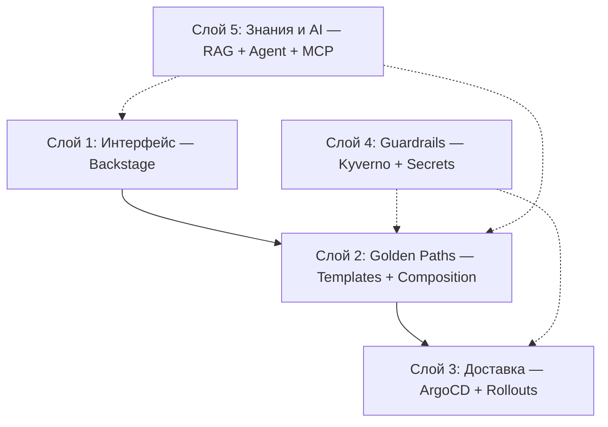
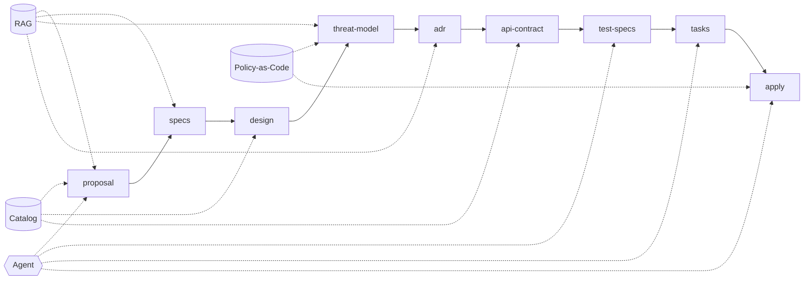

# IDP Blueprint: AI-Augmented Platform Engineering

> **Статус:** Draft
> **Версия:** v0.1
> **Владелец:** Platform Team
> **Последнее обновление:** YYYY-MM-DD
> **Связанные ADR:** [ADR-0001](adr/0001-composition-engine.md), [ADR-0002](adr/0002-kargo-vs-rollouts.md), [ADR-0003](adr/0003-token-exchange-mcp.md)

---

## 1. Контекст и цели

### 1.1 Проблема
<!-- Фрагментация знаний, когнитивная нагрузка, отсутствие безопасного способа
     использовать AI-агентов в SDLC. -->

### 1.2 Цели
- Единая точка входа для разработчиков.
- Снижение Time to First Deploy.
- Безопасная интеграция AI/RAG без компромисса по Zero Trust.
- Управляемое выполнение агентских цепочек с аудитом.

### 1.3 Границы blueprint
**Входит:** архитектура слоев 1–5, паттерны безопасности агентской цепочки,
рекомендации по команде и дорожной карте.

**Вне рамок:** выбор облака/LLM-провайдера, закупка лицензий, детальные runbooks.

### 1.4 Ключевой принцип
> AI-слой не имеет собственных привилегий — он наследует права пользователя.

---

## 2. Целевая архитектура (5 слоев)

### 2.1 Слой 1 — Интерфейс (Backstage)
<!-- Каталог, TechDocs, Software Templates. -->

### 2.2 Слой 2 — Golden Paths
<!-- Композиция ресурсов. Выбор движка — см. ADR-0001. -->

### 2.3 Слой 3 — Доставка
<!-- ArgoCD + Argo Rollouts. Kargo — см. ADR-0002. -->

### 2.4 Слой 4 — Guardrails
<!-- Kyverno (admission + dry-run), External Secrets Operator. -->

### 2.5 Слой 5 — Знания и AI
<!-- RAG по TechDocs + каталогу, MCP Server, агентская цепочка. -->

### 2.6 RAG vs MCP: границы применимости

RAG и MCP решают разные задачи. RAG превращает AI в «читателя документов»,
MCP — в «полноценного клиента платформенных API». Для platform engineering
это принципиальный сдвиг, потому что значительная часть знаний платформы
не является текстом.

| Тип знания | Источник | Способ доступа | Почему |
| :--- | :--- | :--- | :--- |
| Документация, ADR, runbooks | TechDocs | RAG (через MCP-инструмент `rag.query`) | Медленные знания, актуальность не критична, стоимость retrieval низкая |
| Каталог: владельцы, зависимости, API | Backstage Catalog | MCP (`catalog.getEntity`, `catalog.getDependents`) | Граф, а не текст; нужен точный ответ в момент запроса |
| Статус деплоя, CI/CD | ArgoCD, CI | MCP (`deployments.getStatus`) | Меняется каждую секунду; индекс не успеет |
| Политики и их нарушения | Kyverno | MCP (`kyverno.dryRun`, `kyverno.getViolations`) | Структурированный ответ, нужен для решения |
| Метрики, логи, трейсы | Observability | MCP (`metrics.query`, `logs.search`) | Динамические данные, RAG неприменим |

**Принцип:** RAG выставляется как один из инструментов MCP-сервера,
а не как единственный канал знаний. Агент сам решает, когда искать по документам,
а когда — запрашивать живой API. См. ADR-0005.
---

## 3. Технологический стек

| Слой | Инструмент | Обоснование | Альтернатива | Критерий переключения |
| :--- | :--- | :--- | :--- | :--- |
| Интерфейс | Backstage | Стандарт де-факто, CNCF | OpenChoreo | Нужна готовая сборка «из коробки» |
| Композиция | Crossplane | Мультиоблачность, декларативность | ACK | Глубоко в AWS, мультиоблачность не нужна |
| Доставка | ArgoCD + Rollouts | GitOps, canary | Flux + Flagger | Предпочтение команды |
| Политики | Kyverno | Простота, CNCF | OPA Gatekeeper | Нужна сложная логика на Rego |
| Векторная БД | pgvector | Одна БД для всего | Qdrant | Нужна быстрая фильтрация на больших объемах |
| LLM | Ollama (self-hosted) | Нет передачи данных в облако | Облачный провайдер | Нужна недоступная локально модель |
| MCP | MCP Server (платформенный) | Единая точка интеграции инструментов, включая RAG как один из инструментов | — | — |

---

## 4. Процесс SDLC с IDP

### 4.1 Диаграмма процесса

### 4.2 Что меняется на каждом шаге

| Шаг | Без IDP | С IDP |
| :--- | :--- | :--- |
| proposal | Пустой документ | Шаблон + RAG-контекст |
| specs | Вручную | Генерация + валидация против стандартов |
| design | Вручную | Golden Path выбирает композицию |
| threat-model | Post-factum | Автогенерация + Kyverno dry-run |
| adr | Теряется в вики | TechDocs → RAG → контекст будущих решений |
| api-contract | Вручную | Генерация + openapi-diff |
| test-specs | Отдельно | Из контракта + шаблоны |
| tasks | Вручную | Draft backlog от агента, sign-off Tech Lead |
| apply | kubectl apply | ArgoCD + Kyverno admission + Permission Framework |

---

## 5. Безопасность агентской цепочки

### 5.1 Sequence diagram: threat-model → api-contract → apply
<!-- Вставить Mermaid-диаграмму. -->

### 5.2 Поток авторизации MCP Server
<!-- Вставить Mermaid-диаграмму. -->

### 5.3 Hardening
- **Token Exchange (RFC 8693):** scoped-токен с `aud=mcp-server`, TTL 30–60 с. См. ADR-0003.
- **Mid-flight revocation:** `introspect` с Redis-кэшем TTL 5–10 с + события отзыва сессий от IdP.
- **Маскирование в аудите:** PII/секреты в параметрах tool-call — детекция и хэширование.

### 5.4 Circuit Breaker
<!-- State machine + sequence diagram. -->

**Триггеры:**
- 2 `forbidden` подряд.
- N ошибок tool-call подряд.
- **Превышение бюджета токенов на цепочку** — отдельно для RAG-инструментов
  и MCP-инструментов. Tool-calling может быть на порядки дороже RAG;
  агент, застрявший в цикле вызовов, сожжёт бюджет быстрее.
- Явный `forbidden` на критичный инструмент (например, `deploy:*`).

### 5.5 Что явно запрещено
- JWT в промпте или в контексте LLM.
- Проброс точной причины `forbidden` в LLM.
- Повторные попытки обхода `forbidden` агентом.
- Админские инструменты в allowlist MCP.

---

## 6. Команда и роли

### 6.1 Костяк (3–5 человек)

| Роль | Зона ответственности |
| :--- | :--- |
| Платформенный инженер / Backend | Backstage, MCP Server, RAG-плагин |
| Инженер автоматизации / IaC | Crossplane/ACK, Terraform |
| DevOps/SRE | ArgoCD, Rollouts, кластеры, мониторинг |
| Security / Policy-as-Code | Kyverno, External Secrets, Permission Framework |

### 6.2 Роли поверх костяка
- **Product Owner платформы** (0.5 ставки) — голос разработчика, приоритизация.
- **Frontend/DevEx** (опционально) — UX Backstage и RAG-ассистента.

### 6.3 Масштаб

| Размер организации | Рекомендация |
| :--- | :--- |
| < 100 инженеров | 1 выделенный инженер |
| 100–500 | 3–5 человек |
| 500+ | 6–10+, разделение на подкоманды |

---

## 7. Дорожная карта внедрения

| Итерация | Что делаем | Критерий перехода |
| :--- | :--- | :--- |
| 1. Базовый контур | Backstage + каталог + TechDocs + ArgoCD + Kyverno | Разработчики используют каталог, деплой через GitOps |
| 2. Golden Paths | Software Templates + Crossplane/ACK | Time to First Deploy < N часов |
| 3. RAG-ассистент | Индексация + Ollama + pgvector | Ассистент отвечает с цитатами |
| 4. Агентская цепочка | MCP Server + Permission Framework + circuit breaker | Агент выполняет tool-call с аудитом |
| 5. Продвинутая доставка | Argo Rollouts + (опционально) Kargo | Canary с автоматическим откатом |

---

## 8. Метрики и observability

### 8.1 DORA
- Deployment Frequency
- Lead Time for Changes
- Change Failure Rate
- Time to Restore

### 8.2 Платформенные
- Time to First Deploy
- Adoption Rate
- TechDocs freshness

### 8.3 Агентская цепочка
- `forbidden_total{user, tool}`
- `circuit_breaker_state{user, tool}`
- `chain_aborted_total{reason}`
- `tokens_burned_on_forbidden`
- `tool_call_latency{tool}`

---

## 9. Риски и открытые вопросы

### 9.1 Принятые риски и меры

| Риск | Мера |
| :--- | :--- |
| Security by Checkbox в threat-model | Async sign-off для high/critical + Kyverno dry-run |
| Галлюцинации при декомпозиции tasks | Draft backlog + sign-off Tech Lead |
| Устаревание индекса RAG | Инвалидация по вебхукам + `commit_sha` в чанках |
| Privilege escalation через агента | Impersonation + circuit breaker + allowlist |
| Shadow agents | Платформа как единственный безопасный путь |
| Перекос в сторону RAG: агент ищет всё в документах, хотя часть знаний — в API | Явное разделение в 2.6 + инструкция в system prompt: «для статуса/каталога/политик — вызывай MCP-инструмент, не ищи в RAG» |

### 9.2 Открытые вопросы
- [ ] Выбор движка композиции — ADR-0001.
- [ ] Нужен ли Kargo на текущем масштабе — ADR-0002.
- [ ] Политика хранения аудит-логов — ADR-0004.
- [ ] Выбор LLM-модели для self-hosted.

---

## 10. Приложения

### 10.1 Глоссарий

| Термин | Определение |
| :--- | :--- |
| IDP | Internal Developer Platform |
| Golden Path | Стандартизированный путь создания и доставки сервиса |
| MCP | Model Context Protocol |
| RFC 8693 | OAuth 2.0 Token Exchange |
| Circuit Breaker | Автомат, останавливающий цепочку при повторных ошибках |
| Impersonation | Выполнение действий от имени пользователя |

### 10.2 Ссылки на ADR
- [ADR-0001: Выбор движка композиции](adr/0001-composition-engine.md)
- [ADR-0002: Kargo vs Argo Rollouts](adr/0002-kargo-vs-rollouts.md)
- [ADR-0003: Token Exchange для MCP](adr/0003-token-exchange-mcp.md)
- [ADR-0004: Политика аудит-логов](adr/0004-audit-log-policy.md)
